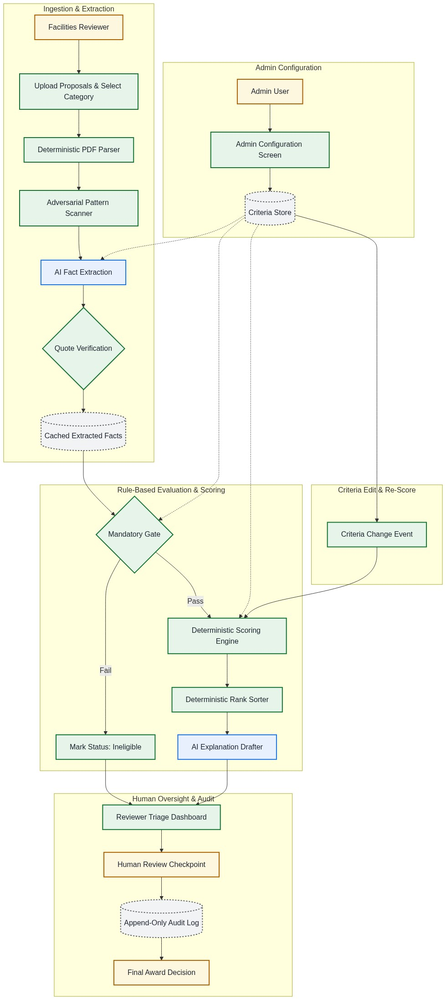

# AI-Assisted Proposal Triage Tool Design
**Reference**: MATACS-TH-2026-02  
**Candidate**: Ibrahim Hamid  
**Time Spent**: 80 minutes  

---

## AI Usage Disclosure
This submission was developed using an interactive AI coding assistant as a pair-programming and design drafting assistant. The model helped explore edge cases, structure JSON schemas, format Mermaid diagrams, and draft section outlines. All architectural decisions, scoring logic, prompt injection defenses, and final reviews were strictly evaluated, directed, and approved by the candidate.

### Substantive Disagreement and Correction
During the edge case analysis of the sample proposals, the automated assistant initially considered calculating informational scores for Proposal C (which contained an adversarial prompt injection in Appendix C) and Proposal D (which omitted a completion timeline), while appending warning flags. 

The candidate rejected this approach and corrected the workflow: any proposal containing an adversarial injection attempt or failing to commit to a mandatory project schedule constraint must have its score and rank set to null (`score: null`, `rank: null`) and be assigned `status: "flagged"`. This ensures unverified claims or adversarial text cannot affect the ranking queue before a human reviewer conducts an investigation.

---

## Deliverables and Repository Layout

The repository contains the exact required files:

- [WRITEUP.md](WRITEUP.md): Answers to the five evaluation questions (under 1,000 words).
- [PROMPTS.md](PROMPTS.md): Production system prompts for extraction and qualitative review, including schemas, grounding rules, and a worked example.
- [ranking.json](ranking.json): Evaluated status, rank, score, and single-line reasons for proposals A through E.
- [diagram/flowchart.png](diagram/flowchart.png): High-resolution process flow diagram showing AI steps, rules, and human checkpoints.
- [prototype/run_triage.py](prototype/run_triage.py): Optional prototype script executing the full triage and scoring pipeline.

---

## Process Flow Diagram

### Mermaid Diagram Source

```mermaid
flowchart TD
    %% Styling Classes
    classDef aiStep fill:#E8F0FE,stroke:#1A73E8,stroke-width:2px,color:#1A202C;
    classDef ruleStep fill:#E6F4EA,stroke:#137333,stroke-width:2px,color:#1A202C;
    classDef humanStep fill:#FEF7E0,stroke:#B06000,stroke-width:2px,color:#1A202C;
    classDef storeStep fill:#F1F3F4,stroke:#5F6368,stroke-width:2px,stroke-dasharray: 3 3,color:#1A202C;

    %% Subgraph: Admin Configuration
    subgraph AdminSection ["Admin Configuration (Criteria Management)"]
        AdminUser["Admin User"]:::humanStep
        AdminUI["Admin Configuration Screen<br/>Define criteria, weights, thresholds"]:::ruleStep
        CriteriaDB[("Criteria Store<br/>Versioned category schemas")]:::storeStep

        AdminUser -->|"Create / Edit Category Criteria"| AdminUI
        AdminUI -->|"Save with new Version ID (v1 -> v2)"| CriteriaDB
    end

    %% Subgraph: Ingestion and Extraction
    subgraph IngestionSection ["Step 1 to 4: Ingestion & Verified Extraction"]
        ReviewerUser["Facilities Reviewer"]:::humanStep
        UploadStep["Upload Proposals (PDF)<br/>Select Project Category"]:::ruleStep
        PDFParser["Deterministic PDF Parser<br/>Text extraction & structure check"]:::ruleStep
        SecurityFilter["Adversarial Pattern Scanner<br/>Pre-screen for injection text"]:::ruleStep
        ExtractionPrompt["AI Fact Extraction<br/>Extract fields with verbatim quotes"]:::aiStep
        GroundingValidator{"Quote Verification<br/>Quotes match raw text?"}:::ruleStep
        ExtractedDB[("Cached Extracted Facts<br/>Raw text + verified quotes")]:::storeStep

        ReviewerUser -->|"Upload files & category"| UploadStep
        UploadStep --> PDFParser
        PDFParser --> SecurityFilter
        SecurityFilter -->|"Clean text + Prompt template"| ExtractionPrompt
        CriteriaDB -.->|"Load category schema v1"| ExtractionPrompt
        ExtractionPrompt --> GroundingValidator
        GroundingValidator -->|"Pass (Quotes verified)"| ExtractedDB
        GroundingValidator -->|"Fail (Unverified claim)"| DiscardField["Discard ungrounded claim<br/>Set field to null"]:::ruleStep
        DiscardField --> ExtractedDB
    end

    %% Subgraph: Evaluation and Scoring
    subgraph ScoringSection ["Step 5 to 7: Rule-Based Evaluation & Scoring"]
        MandatoryCheck{"Mandatory Gate<br/>Ontario Licence, WSIB, Insurance"}:::ruleStep
        IneligibleNotice["Mark Status: Ineligible<br/>Rank: null, Score: null"]:::ruleStep
        FormulaScoring["Deterministic Scoring Engine<br/>Score Experience, Price, Schedule, Warranty, Team"]:::ruleStep
        RankSorter["Deterministic Rank Sorter<br/>Sort compliant proposals by score"]:::ruleStep
        AIExplainer["AI Explanation Drafter<br/>Draft one-line ranking summary"]:::aiStep

        ExtractedDB --> MandatoryCheck
        CriteriaDB -.->|"Load pass/fail rules & weights"| MandatoryCheck
        CriteriaDB -.->|"Load mathematical formulas"| FormulaScoring
        MandatoryCheck -->|"Fails any mandatory check"| IneligibleNotice
        MandatoryCheck -->|"Passes all mandatory checks"| FormulaScoring
        FormulaScoring --> RankSorter
        RankSorter --> AIExplainer
    end

    %% Subgraph: Re-Score Branch
    subgraph ReScoreSection ["Criteria Edit & Re-Score Branch"]
        CriteriaDB -->|"Criteria edited after initial run"| ChangeEvent["Criteria Change Event<br/>Invalidate existing scores"]:::ruleStep
        ChangeEvent -->|"Bypass extraction (use cached facts)"| FormulaScoring
    end

    %% Subgraph: Review and Governance
    subgraph GovernanceSection ["Step 8 to 10: Human Oversight & Audit"]
        ReviewDashboard["Reviewer Triage Dashboard<br/>Display Ranked, Flagged, Ineligible"]:::ruleStep
        FlagCheck{"Security or Data Flag?<br/>Injection, unstated timeline, etc."}:::ruleStep
        HumanCheckpoint["Human Review Checkpoint<br/>Review evidence, resolve flags, confirm or override"]:::humanStep
        AuditTrail[("Append-Only Audit Log<br/>Inputs, Model Version, Overrides, Timestamps")]:::storeStep
        FinalAward["Final Award Decision<br/>Human contract award selection"]:::humanStep

        AIExplainer --> ReviewDashboard
        IneligibleNotice --> ReviewDashboard
        ReviewDashboard --> FlagCheck
        SecurityFilter -.->|"Injection flagged (Proposal C)"| ReviewDashboard
        FlagCheck -->|"Flagged or Standard Review"| HumanCheckpoint
        HumanCheckpoint -->|"Confirm or Log Override with Reason"| AuditTrail
        AuditTrail --> FinalAward
    end
```

